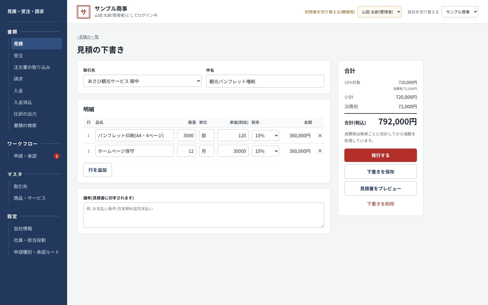
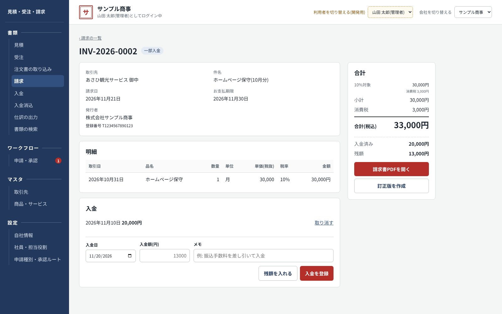
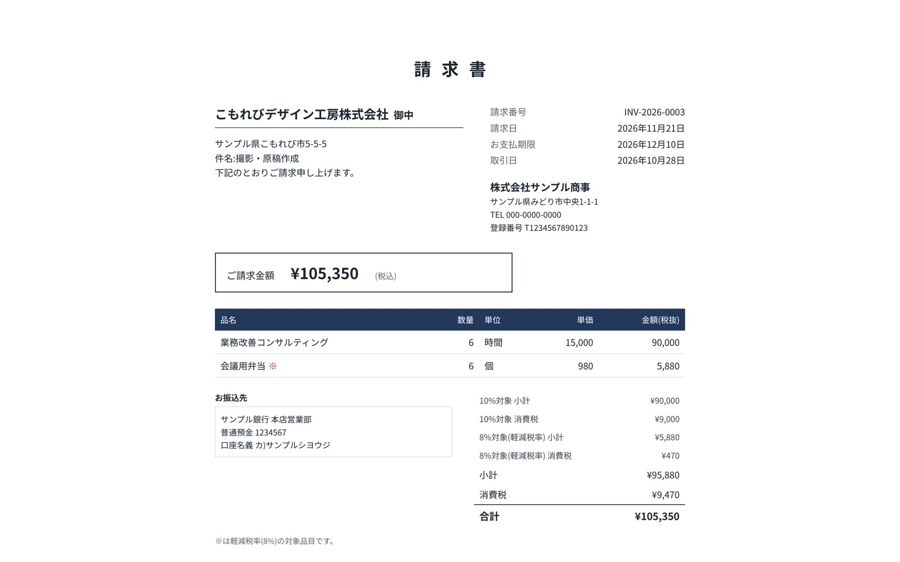
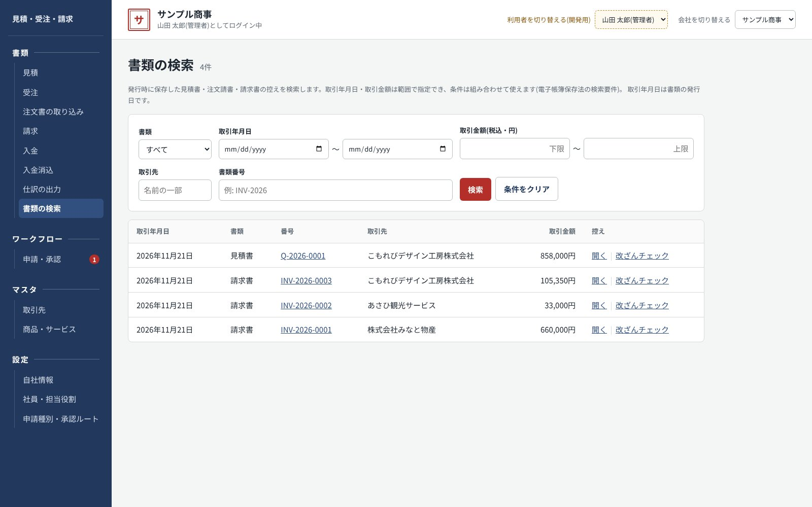
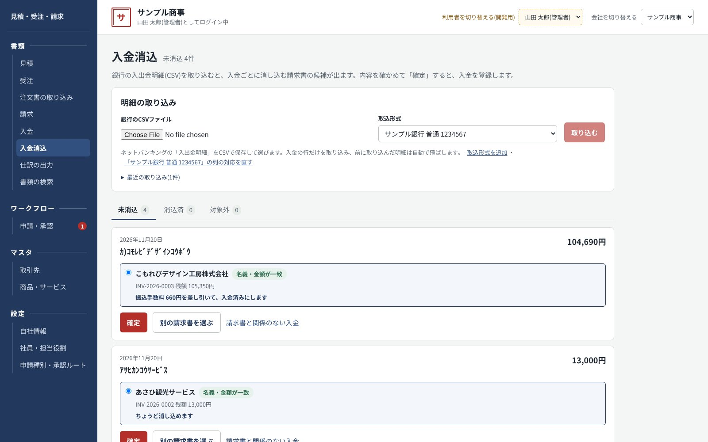
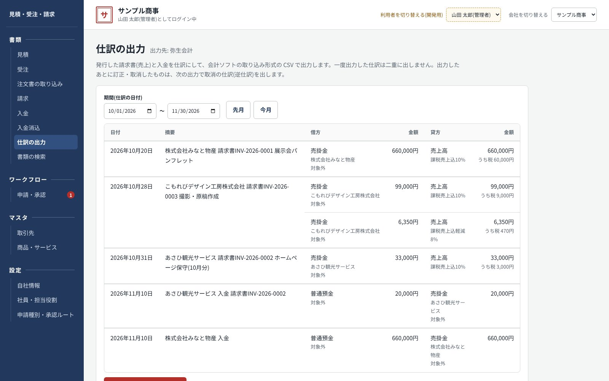
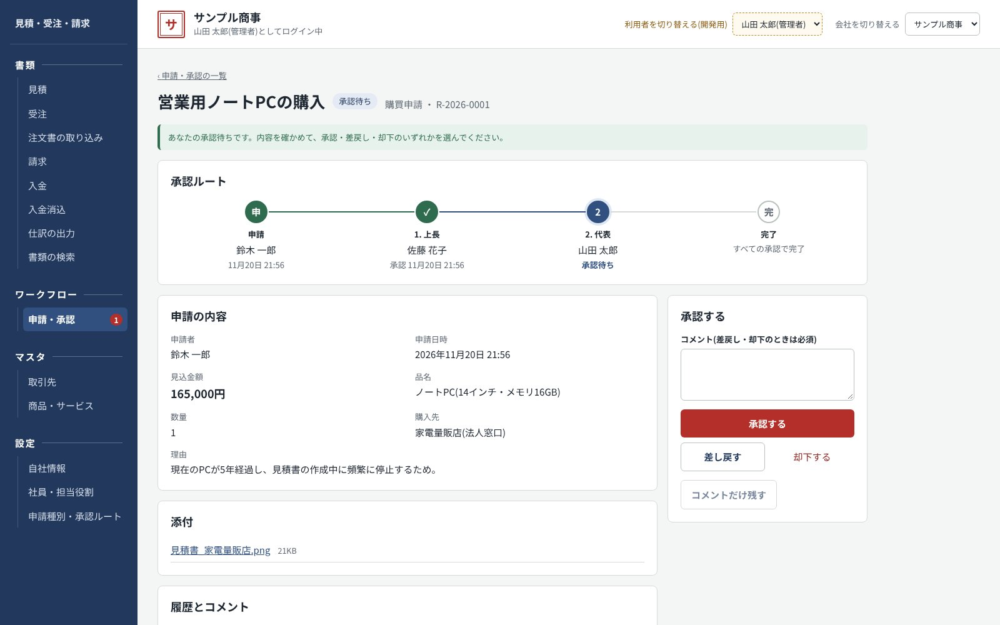
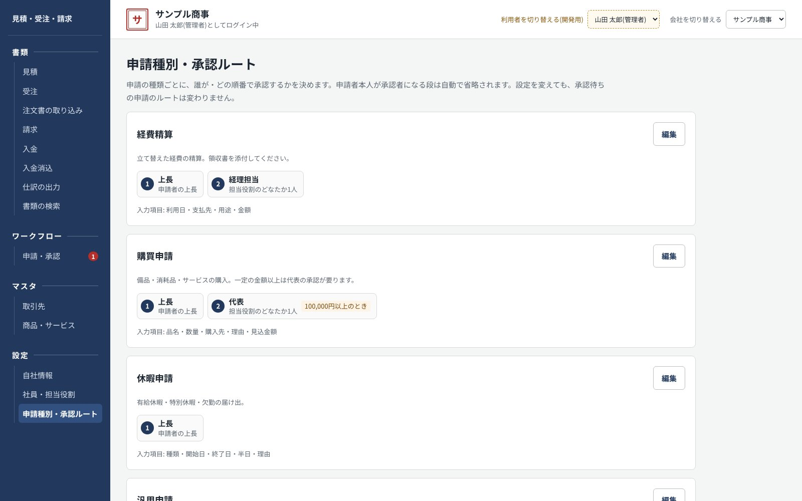
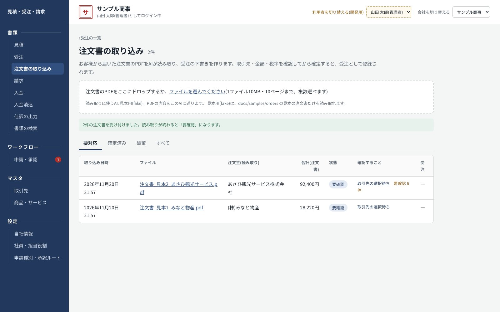
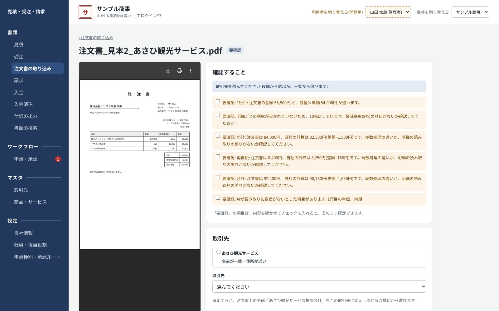

# 見積・受注・請求アプリ(開発環境)

中小企業向けの見積・受注・請求アプリの開発用の雛形です。
DB(PostgreSQL)・API(Python / FastAPI)・画面(React)を Docker Compose でまとめて起動します。

> **開発中です。本番環境では使えません。** ログイン(認証)が未実装で、開発用の固定ユーザーで動きます。
> 法令(インボイス制度・電子帳簿保存法)への対応は実装上の工夫であり、適合を保証するものではありません。

主な特徴

- 1つのコードとコンテナイメージで、SaaS(複数社で共有)と顧客ごとの専用環境の両方に対応
- 会社ごとのデータ分離を、API の確認と DB の行レベルセキュリティ(RLS)の二重で実施
- インボイス制度に沿った請求書(税率ごとに1回の端数処理、取引日、登録番号)と訂正版の発行
- 発行した書類は控えPDFとハッシュ値を保存し、変更・削除をDBのトリガーで禁止(電子帳簿保存法を想定)
- 月締めのまとめ請求、繰越の表示、取引先ごとのまとめ入金
- 個人事業主に対応(屋号と氏名の印字、免税事業者の消費税なし表示、源泉徴収税額の計算と差引ご請求額での入金管理)
- 取引先ごとの締め日・支払日、商品・サービスマスタからの明細入力
- 解約・乗り換えに備えたデータ一式の書き出し(CSV と控えPDFを ZIP にまとめる)
- 入金消込(銀行の入出金明細CSVを取り込み、振込名義と金額から請求書の候補を出して確定。振込手数料の差引にも対応)
- 会計ソフト向けの仕訳CSV(勘定奉行・弥生会計・freee会計・マネーフォワード クラウド会計。二重出力の防止と、訂正・取消の逆仕訳)
- ワークフロー(申請・承認)。経費精算・購買申請・休暇申請・汎用申請を、上長・担当役割(経理担当・代表など)の順に承認。承認ルートは申請時に自動で組み立て、金額の条件で段を足し、申請者本人の段は省略。差戻し・再申請・却下・取下げ・コメント・添付(スマホで完結)
- 社員(上長・部署)と担当役割、申請種別ごとの承認ルートを画面で設定
- AI による注文書の取り込み(LangChain・LangGraph)。お客様の注文書PDFを AI が読み取って受注の下書きを作り、人が確認して確定する。AI は読み取りだけで、取引先・商品の照合と金額・税率・重複の検証は普通のコードで行い、金額は自社の設定で計算し直す。AI の値と人が直した値を記録し、提供元(OpenAI 互換 API・Ollama など)を切り替えられる

## 画面

| 見積の作成(商品マスタから明細を入力) | 請求書(一部入金の管理) |
| --- | --- |
|  |  |
| **請求書PDF(インボイス対応)** | **書類の検索(電子帳簿保存法の検索要件)** |
|  |  |
| **入金消込(銀行の明細から請求書の候補を出す)** | **仕訳の出力(会計ソフトの取り込み形式)** |
|  |  |
| **申請と承認ルート(ワークフロー)** | **申請種別・承認ルートの設定** |
|  |  |
| **注文書の取り込み(AI)** | **取り込みの確認(元のPDFと見比べて確定)** |
|  |  |

画面のデータ(会社・取引先・社員・口座・登録番号)はすべて架空です。

## フォルダ構成

```
sme-app/
├─ docker-compose.yml   開発環境の起動設定
├─ Dockerfile           本番用(画面と API を1つのイメージにまとめる)
├─ db/
│  ├─ migrations/       スキーマ(番号順に流す)
│  ├─ dev/              開発用のログインユーザーとサンプルデータ
│  └─ tests/            DB の動作確認(RLS・発行済み書類の保護など)
├─ api/                 FastAPI
│  ├─ app/
│  │  ├─ main.py        入口
│  │  ├─ config.py      環境変数の読み込み
│  │  ├─ db.py          接続と、リクエストごとの会社の設定
│  │  ├─ auth.py        利用者の特定と所属の確認
│  │  ├─ routers/       API(会社一覧・取引先・商品・社員・申請と承認・見積・受注・請求・入金・入金消込・仕訳CSV・書類の検索・自社情報・データの書き出し・金額計算)
│  │  ├─ schemas.py     見積・受注で共通の入出力の型
│  │  ├─ documents.py   見積・受注で共通の処理(明細の書き込みなど)
│  │  ├─ pricing.py     書類の金額計算(会社設定と日付時点の税率を使う)
│  │  ├─ pdf/           見積書・注文請書・請求書のテンプレートと生成(WeasyPrint)
│  │  ├─ domain/text.py 全角英数字の半角化
│  │  ├─ domain/terms.py 締め日と支払期限の計算
│  │  ├─ domain/withholding.py 源泉徴収税額の計算
│  │  ├─ domain/bank.py 銀行CSVの読み取り(文字コード・日付・金額)と振込名義の正規化
│  │  ├─ domain/journal.py 仕訳の形と、会計ソフトごとのCSVへの変換
│  │  ├─ domain/workflow.py 申請・承認の決まり(承認ルートの組み立て・入力項目の確認・状態ごとの操作)
│  │  ├─ domain/names.py 会社名の正規化(法人格・全角半角・敬称をそろえる)
│  │  ├─ domain/import_checks.py 注文書の取り込みの照合と検証(AI を使わない普通のコード)
│  │  ├─ ai_import/      注文書の取り込み(LangGraph の流れ・抽出スキーマ・PDFの文字の取り出し・AI の提供元・指示文)
│  │  ├─ storage.py     発行控えPDFと申請の添付の保存
│  │  └─ domain/tax.py  消費税の計算(税率ごとに1回だけ端数処理)
│  ├─ scripts/          見本の注文書PDFを作るスクリプト
│  └─ tests/            pytest
└─ web/                 React + Vite
```

## 起動

Docker Desktop を起動した状態で、このフォルダで次を実行します。初回はイメージのダウンロードなどで数分かかります。

```powershell
docker compose up -d
```

起動後、ブラウザで次を開きます。

- 画面: http://localhost:5173
- API の仕様書: http://localhost:8000/docs

画面では「サンプル商事」と「テスト工業」の2社を切り替えられます。会社を切り替えると、その会社のデータだけが表示されます。

- 見積: 作成・下書き保存・見積書PDFのプレビュー・発行(採番と控えPDFの保存)・失注・受注への変換
- 受注: 見積からの変換・直接登録・変更(未請求のあいだ)・削除・注文請書のプレビューと発行(版ごとに控えを保存)
- 請求: 受注からの作成・月締めのまとめ請求(前回までの未入金を繰越として表示)・直接作成・発行(インボイス対応)・一部入金・訂正版・取消
- 入金: 取引先ごとのまとめ入金(未入金の請求書へ古い順に割り当て)と取消
- 入金消込: 銀行の入出金明細(CSV)を取り込み、入金ごとに請求書の候補を出して確定する
  - 銀行ごとに列の並びが違うので、最初に「取込形式」(どの列が取引日・入金額・振込名義か)を画面で設定する。見出しから自動で推測する
  - 文字コード(Shift_JIS / UTF-8)、和暦・西暦の日付、桁区切りや「円」付きの金額を読める。出金の行と、取り込み済みの明細は飛ばす
  - 候補は「名義と金額が一致」「金額だけ一致」「名義だけ一致(一部入金)」の順に出す。振込名義は半角カナ・法人の略語(カ)など)の違いをそろえて照合する
  - 請求額との差額が上限(自社情報で設定、初期値880円)以内なら「振込手数料」として消し込み、請求書を入金済みにする
  - 確定すると、その振込名義を取引先に登録し、次からは名義で候補に出す。請求書と関係のない入金(利息など)は対象外にできる
  - 試し用の明細: `docs/samples/bank-sample.csv`(Shift_JIS。取引先名・金額は架空なので、手元のデータに合わせて書き換えて使う)
- 仕訳の出力: 発行した請求書(売上)と入金を仕訳にして、会計ソフトの取り込み形式のCSVで出力する
  - 売上は税率ごとに「売掛金 / 売上高」(税額は請求書の税率ごとの消費税額)、源泉徴収は「仮払税金(個人事業主は事業主貸) / 売掛金」
  - 入金は「普通預金 / 売掛金」、振込手数料は「支払手数料 / 売掛金」(課税仕入)
  - 売上の計上日は、取引日(締め請求は締め日、それ以外は最後の納品日)か請求日を選べる
  - 出力した仕訳は記録して二重に出さない。出力後に訂正・取消した請求書や、取り消した入金は、次の出力で逆仕訳を出す。最後の出力は取り消して出し直せる
  - 勘定科目・補助科目・税区分の名前は、会計ソフトの設定に合わせて画面で変えられる。勘定奉行は科目コードと消費税区分コードの入力が必要(コードは奉行の版によって違うため初期値なし)
  - 文字コードは Shift_JIS。形式は各社の公開しているヘルプに合わせているが、会計ソフトの版や設定によって違うことがあるので、最初は少ない件数で取り込みを試すこと
- 注文書の取り込み(AI): お客様から届いた注文書PDFを AI が読み取り、受注の下書きを作る。人が確認して確定すると受注になる
  - 初期値はオフ。管理者が自社情報の画面の「AIによる注文書の取り込み」でオンにする(オンにすると PDF の内容を AI のサービスに送るため)
  - 流れ: 取り込み(処理待ち)→ 読み取り(種類の判定 → 項目の抽出)→ 要確認 → 確定 / 破棄。AI を待つあいだは DB のトランザクションを開けたままにしない
  - 取引先は候補(名前・住所の近さと理由)を出すだけで、自動では決めない。確定すると注文書上の名前を取引先に覚え、次からは最初から選ぶ
  - 金額は自社の設定(端数処理・税率)で計算し直し、注文書の金額・小計・税額・合計と合わなければ警告する。ほかに、同じ取引先の同じ注文番号(エラー)、宛先が自社でない、税込みの単価、税率の記載なし、日付の矛盾、AI が自信のない項目を警告する
  - エラーは直すまで確定できない。警告は1件ずつ確認のチェックを入れれば確定できる
  - 確定すると、AI の値と人が確定した値の違いを項目ごとに記録する(精度の集計用)。取り込んだ PDF と記録は消さない(破棄しても残す)
  - 受注には「お客様の注文番号」を持たせ、注文請書に「貴社注文番号」として印字する
  - 文字情報のない PDF(スキャンした画像)にはまだ対応していない
  - 試し方: `docker-compose.yml` の既定は `AI_PROVIDER=fake`(APIキー不要)。fake は `docs/samples/orders` の見本の注文書2枚にだけ決まった答えを返す。見本2は単価を読み違えた例で、金額の警告が出る
- 書類の検索: 発行済みの控えを取引年月日・取引金額・取引先で検索(電子帳簿保存法の検索要件)、控えの改ざんチェック
- 取引先: 一覧・追加・編集・使用中止。締め日・支払日を取引先ごとに設定(空なら自社情報の設定に従う)。入金消込に使う振込名義
- 商品・サービス: 一覧・追加・編集・使用中止。明細の品名欄で候補から選ぶと、単位・単価・税率が入る
- 社員・担当役割(設定): 社員の氏名・部署・上長・権限(管理者/一般)・使用中止、担当役割(経理担当・代表など)と担当する社員。変更は管理者だけ
  - 上長の関係が一周する設定や、部下がいる社員の使用中止、管理者がいなくなる変更は止める
  - 開発用のサンプル社員: 山田 太郎(代表・管理者)、佐藤 花子(営業部長)、鈴木 一郎(営業部)、田中 美咲(経理)
- 自社情報: 事業形態(法人/個人事業主)、課税/免税、書類に印字する会社名・屋号と氏名・登録番号・振込先、締め日と支払日(変更は管理者だけ)、データ一式のダウンロード(管理者だけ)
- 源泉徴収(個人事業主のみ): 取引先ごとの初期値と請求書ごとの選択。税抜金額の10.21%(100万円を超える部分は20.42%)を差し引き、差引ご請求額で入金を管理

コードを保存すると API・画面とも自動で読み込み直します。

## テスト

```powershell
# 消費税の計算と API のテスト
docker compose exec api pytest

# DB のテスト(会社ごとの分離、発行済み書類の保護など。最後にすべて取り消す)
docker compose exec db psql -U postgres -q -v ON_ERROR_STOP=1 -f /db/tests/001_smoke_test.sql
```

## 実際の AI で注文書を読み取るとき

AI の提供元は環境変数で切り替えます。LangChain の ChatOpenAI を使うので、OpenAI 互換の API なら同じ設定で呼べます。
`docker-compose.yml` と同じフォルダに `.env` ファイルを作り、次のように書いてから `docker compose up -d` し直します(`.env` は Git に上げないでください)。

```
# 例1: 手元のPCの Ollama(APIキー不要。モデルは事前に ollama pull しておく)
AI_PROVIDER=openai_compatible
AI_BASE_URL=http://host.docker.internal:11434/v1
AI_MODEL=(Ollama のモデル名)

# 例2: クラウドの OpenAI 互換 API(エンドポイントとモデル名は各サービスの案内に従う)
AI_PROVIDER=openai_compatible
AI_BASE_URL=(サービスの OpenAI 互換エンドポイント)
AI_MODEL=(モデル名)
AI_API_KEY=(APIキー)
```

- 構造化出力は既定で関数呼び出し(function calling)を使います。対応していないモデルでは `AI_STRUCTURED_METHOD=json_mode` を試してください
- 無料枠のサービスでは、送ったデータがサービスの改善に使われる条件のことがあります。架空の書類だけで試し、実際の取引先の書類は有料の契約か手元のモデルで扱ってください
- 1回の呼び出しの上限時間は `AI_TIMEOUT_SECONDS`(初期値60秒)、読むページ数の上限は `AI_MAX_PAGES`(初期値10)です

## 更新したコードを取り込むとき

DB のスキーマが変わったときや、API の部品(requirements.txt・Dockerfile)が変わったときは、
DB を作り直し、API のイメージを作り直してから起動します。DB のデータは消えます。

```powershell
docker compose down -v
docker compose up -d --build
```

## 停止・初期化

```powershell
docker compose down      # 停止(データは残る)
docker compose down -v   # 停止して DB を初期化(スキーマを変えたときはこちら)
```

DB の初期化(`db/dev/initdb.sh`)は、DB を初めて作るときにしか実行されません。
`db/migrations` の SQL を番号順に流してから、`db/dev` の開発用データを入れます。
`db/migrations` や `db/dev` を変更したら、`down -v` で作り直してください。

発行した見積書・注文請書・請求書の控えPDFは、Docker のボリューム(documents)に保存されます。`down -v` で消えます。

## うまく動かないとき

```powershell
docker compose ps            # 各サービスの状態
docker compose logs api      # API のログ
docker compose logs web      # 画面のログ
```

画面のコンテナが `npm ci` で失敗する場合は、`docker-compose.yml` の web の `command` を
`sh -c "npm install && npm run dev"` に変えて試してください。

## 開発用の設定について

- 認証は仮の状態です。`AUTH_MODE=dev` のとき、`DEV_USER_ID` の利用者としてログインしている扱いになります。
  Supabase Auth のトークン検証は `api/app/auth.py` の TODO の箇所に実装します。
- `db/dev/900_dev_setup.sql` と `docker-compose.yml` のパスワードは、手元で動かすための開発用の固定値です。本番では使わないでください。
- サンプルデータの会社・取引先・口座はすべて架空です。登録番号(`T1234567890123` など)は、
  実在の番号と重ならないよう、チェックデジットがわざと合わない番号にしています。
- `AUTH_MODE` を指定しないと、すべての操作を拒否します(本番の認証が未実装のため)。開発では `docker-compose.yml` で `dev` を指定しています。
- 開発モードでは、画面上部の「利用者を切り替える(開発用)」で別の社員として操作できます(申請者と承認者を切り替えて試すため)。
  切り替えは `X-Dev-User-Id` ヘッダーで API に伝え、API は `AUTH_MODE=dev` のときだけこれを読みます。本番では無視されます。
- ワークフローを試すときは、開発用の社員(すべて架空)を次の関係で用意しています。
  鈴木 一郎 → 上長 佐藤 花子 → 上長 山田 太郎(代表・管理者)、田中 美咲(経理担当)→ 上長 山田 太郎。
  たとえば鈴木さんで10万円以上の購買申請を出すと、佐藤さん → 山田さんの順に承認待ちになります。
- 明細金額(数量×単価)の円未満は、消費税と同じ会社設定(初期値は切り捨て)で丸めます。
- データの書き出し(自社情報の画面の「データ一式をダウンロード」)は、選んでいる会社のデータだけを ZIP にします。
  中身は `csv/`(テーブルごと、UTF-8 BOM 付き)、`控えPDF/`、`manifest.csv`(SHA-256 と発行時のハッシュ値)、`はじめにお読みください.txt` です。
